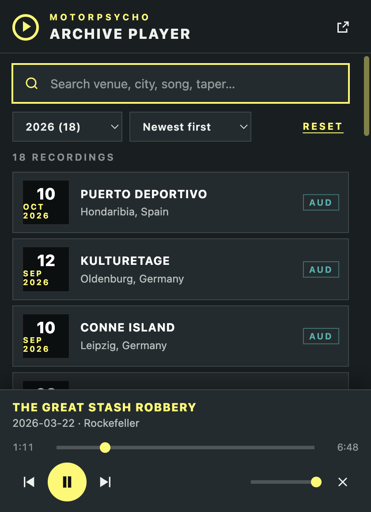
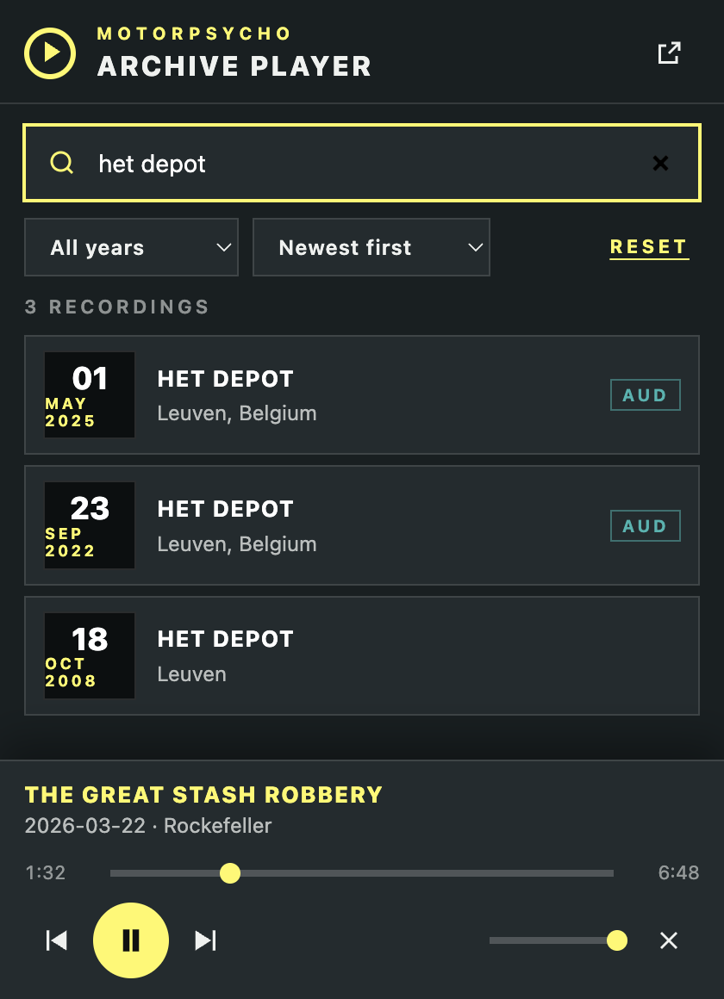
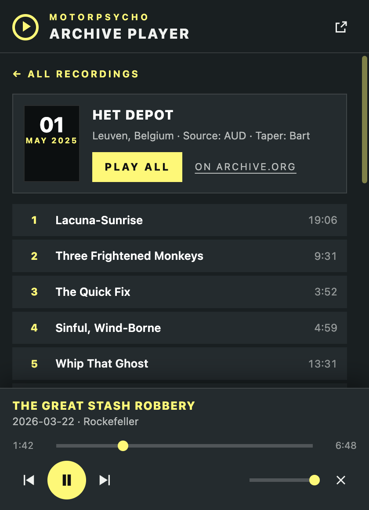

# Motorpsycho Archive Player

A Chrome extension to search and play live recordings from archive.org. It opens on the
[Motorpsycho collection](https://archive.org/details/MotorpsychoBand); in the settings (gear icon) you can switch to
[King Gizzard & The Lizard Wizard](https://archive.org/details/KingGizzardAndTheLizardWizard) or the
[Grateful Dead](https://archive.org/details/GratefulDead).

- **Search**: type a venue, city, song, taper or year. Uses archive.org's own search
  (`advancedsearch`), so every word can be the start of a word in the title, venue or
  description, or a whole word anywhere in the item's text (song titles).
- **Collections**: Motorpsycho (default), King Gizzard & The Lizard Wizard and Grateful Dead. Pick one under the gear icon;
  the choice is remembered. Big collections (the Dead have 18,000+ recordings) load 200 at a time, with "Show more".
- **Random mode**: the Random button (and the shuffle button in the player bar) plays random tracks from the selected
  collection, one after the other. Set a year or a search first and the random tracks stay within it. Next picks
  another random track, previous goes back to the one before. Press shuffle again to switch it off.
- **Year filter** (with the number of recordings per year for the smaller collections) and sort newest/oldest first.
- **Recording view**: all MP3 tracks with their length, Play all, or start from any track.
- **Keeps playing** while the popup is closed, and while you browse. Sound runs in an
  offscreen document, so it does not depend on the popup or on one tab.
- **Mini player**: a small round button in the corner of every page. Hover it and it slides
  open with previous, play/pause, next, maximize (opens the full player in its own window)
  and stop. Drag it anywhere, the position is remembered.
- Hardware media keys and Chrome's media controls work (Media Session).

## Screenshots

**Browse by year.** Pick a year (with the number of recordings) and sort newest or oldest first.
The player bar at the bottom keeps playing while you look around.

**Search.** Type a venue, city, song or taper, for example "het depot".

**Open a recording.** All tracks with their length: play everything or start from any track.

**In your toolbar.** Pin the extension (puzzle piece icon) so it is always one click away.

## Install (developer mode)

1. Open `chrome://extensions`
2. Switch on **Developer mode** (top right)
3. **Load unpacked** and pick this folder (`mp-archive-player`)
4. Pin the extension from the puzzle-piece menu so the toolbar icon is easy to reach

Needs Chrome 116 or newer.

## How it fits together

| File | Role |
| --- | --- |
| `manifest.json` | Manifest V3. Permissions: `offscreen`, `storage`, and access to archive.org. |
| `app.html` / `app.js` / `app.css` | The UI: used as the toolbar popup and (`?window=1`) as the maximized window. Talks to archive.org and sends commands. |
| `background.js` | Service worker: creates the offscreen audio document, remembers the last state, relays state to every tab, opens the player window. |
| `archive.js` | Everything that talks to archive.org (collections, search, years, tracks, random pick). Used by the UI and by the audio engine. |
| `offscreen.html` / `offscreen.js` | The audio engine: one `<audio>` element, the queue, Media Session. Chrome closes this document after a while of silence; the worker then restores queue, track and position the next time you press play. |
| `content.js` | The floating mini player (shadow DOM, so page CSS cannot touch it). |

Messages: UI and mini player send `{type: 'command', cmd: ...}` to the worker, which starts the
offscreen document if needed and forwards the command. The offscreen document answers with
`{type: 'state', state}` (every change) and `{type: 'progress'}` (about once a second, popup only).

## Random mode

archive.org's own "random" sort always returns the same order, so the pick is made in the extension: it counts the
recordings that match, takes a random position and fetches that one recording (and picks a random track of at least a
minute from it). A collection too big to page through (Grateful Dead) is first narrowed to a random year. The audio
engine does this itself, so it keeps going with a new random track when the popup is closed.

## When archive.org cannot deliver a file

`archive.org/download/…` redirects to one storage node, and some nodes answer HTTP 500 (after about 5 seconds)
for files that are fine on the item's original servers (for example every file of `mp2025-05-13`). The player
therefore tries, per track: the item's original servers (from the metadata), then the redirecting address, then
the remaining nodes; if everything fails it waits and goes round again (twice). The address that worked is
remembered for the rest of the recording. Only when all of that fails, a track you picked yourself stays put
with a message; during automatic play it moves on to the next track.

## Good to know

- The mini player does not show on pages where Chrome does not allow extensions
  (`chrome://` pages, the Chrome Web Store, the new tab page). Use the toolbar icon there.
- Recordings and years are cached for 12 hours in `chrome.storage.local`.
- Only the VBR MP3 derivatives are played (never FLAC), same as on mpdb.no.
- No data is sent anywhere except requests to archive.org.
